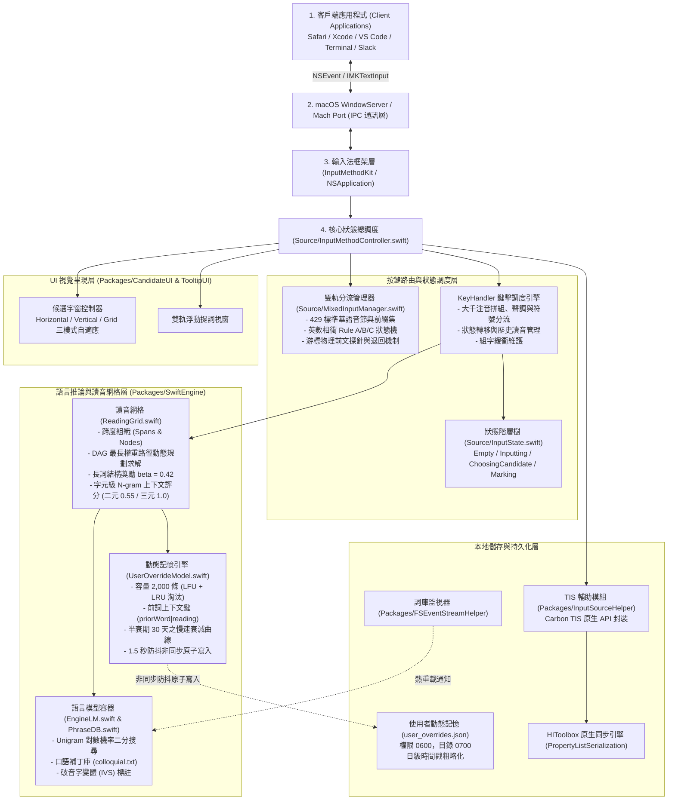

# gg 輸入法 (gg Input Method)
# 工程規格、系統架構、安全自我檢核與維運手冊 (Technical Specification & System Architecture)

**文件版本**：0.4.0 (Semantic-Enhanced POS HMM Syntax Engine & Memory Solidification Pipeline)  
**更新日期**：2026 年 10 月  
**軟體授權**：MIT License（自 v0.3 起的程式碼採 MIT；v0.3 之前的所有提交含 `legacy-coreml-experiment` 標籤依當時之 GPL-3.0 散佈。詳見 `NOTICE`）  
**目標平台**：macOS 13.0 (Ventura) 至 macOS 15 (Sequoia) 及後續相容版本  
**硬體架構**：Apple Silicon 及 Intel (Universal Binary 原生支援)  

---

## 目錄

- [第一篇：產品規格與互動設計 (Product Specification)](#第一篇產品規格與互動設計-product-specification)
  - [1.1 產品定位與功能架構](#11-產品定位與功能架構)
  - [1.2 驗收條件與功能規格矩陣](#12-驗收條件與功能規格矩陣)
  - [1.3 按鍵互動與手動覆寫對照表](#13-按鍵互動與手動覆寫對照表)
  - [1.4 應用程式相容性矩陣](#14-應用程式相容性矩陣)
  - [1.5 無障礙與視覺適配規範](#15-無障礙與視覺適配規範)
- [第二篇：系統架構與演算法規格 (Architecture & Algorithms)](#第二篇系統架構與演算法規格-architecture--algorithms)
  - [2.1 系統分層架構](#21-系統分層架構)
  - [2.2 讀音網格與 DAG 最長權重路徑動態規劃求解](#22-讀音網格與-dag-最長權重路徑動態規劃求解)
  - [2.3 中英雙軌分流與音韻學相衝防禦](#23-中英雙軌分流與音韻學相衝防禦)
  - [2.4 盤古之白自動空格演算法與游標上下文校準](#24-盤古之白自動空格演算法與游標上下文校準)
  - [2.5 macOS TIS 狀態機與 LaunchServices 防重註冊機制](#25-macos-tis-狀態機與-launchservices-防重註冊機制)
  - [2.6 核心詞庫與資料語料規格](#26-核心詞庫與資料語料規格)
  - [2.7 上下文 N-gram 統計評分與長詞獎勵解碼架構](#27-上下文-n-gram-統計評分與長詞獎勵解碼架構)
  - [2.8 語義強化型詞性語法轉移大腦與實戰記憶固化管線](#28-語義強化型詞性語法轉移大腦-semantic-enhanced-pos-hmm-與-實戰記憶固化管線)
- [第三篇：安全、隱私與沙盒自我檢核 (Security & Privacy Self-Audit)](#第三篇安全隱私與沙盒自我檢核-security--privacy-self-audit)
  - [3.1 執行權限、沙盒現況與架構權衡](#31-執行權限沙盒現況與架構權衡)
  - [3.2 安全輸入狀態、終端機防洩漏與資料落地](#32-安全輸入狀態終端機防洩漏與資料落地)
  - [3.3 效能實測基準與量測條件](#33-效能實測基準與量測條件)
  - [3.4 核心功能與效能驗證測試程式碼](#34-核心功能與效能驗證測試程式碼)
  - [3.5 本地記憶體生命週期與零外部相依自我檢核](#35-本地記憶體生命週期與零外部相依自我檢核)
- [第四篇：打包、發佈與維運手冊 (Packaging & Operations)](#第四篇打包發佈與維運手冊-packaging--operations)
  - [4.1 零外部依賴之安裝管線與責任鏈](#41-零外部依賴之安裝管線與責任鏈)
  - [4.2 程式碼簽章、Hardened Runtime 與公證要求](#42-程式碼簽章hardened-runtime-與公證要求)
  - [4.3 反安裝、偏好設定遷移與清理](#43-反安裝偏好設定遷移與清理)
  - [4.4 開源傳承、第三方授權與致謝](#44-開源傳承第三方授權與致謝)
  - [4.5 已知限制與架構維護風險](#45-已知限制與架構維護風險)

---

## 第一篇：產品規格與互動設計 (Product Specification)

### 1.1 產品定位與功能架構
gg 輸入法是一款專為 macOS 平台開發的繁體中文大千注音暨中英雙軌智慧輸入法，源自開源專案 McBopomofo（小麥注音）與 OpenVanilla。自 v0.3 起採用純 Swift 原生高靈敏圖論組字（Viterbi + N-gram Context Walk）結合解碼器長詞獎勵與持久化動態記憶，追求極致低延遲、小體積與無干擾輸入體感。核心目標為：
1. **消除中英切換認知摩擦**：在同一模式下並行辨識注音符號與英文字詞，無需依賴 Caps Lock 或快捷鍵反覆切換鍵盤佈局。
2. **科技詞彙與縮寫防相衝**：解決日常輸入中 `4K`, `3D`, `5G`, `M1`, `1U`, `2U` 等英數縮寫誤觸大千注音聲調與聲母的痛點。
3. **程式設計專用標點直出**：透過 Option 組合鍵提供 100% 確定性的半形 ASCII 符號輸出，阻斷 macOS 預設的冷門歐文字元。
4. **自動排版美學**：依據現代中文排版規範，自動於漢字（CJK）與西文/數字（ASCII）交界處補入半形空格（盤古之白），並對程式碼編輯環境與終端機提供智慧抑制。
5. **解碼長詞結構獎勵與動態記憶持久化**：於動態規劃尋徑引入截斷式長詞結構獎勵（$\beta = 0.42$），根除「穿與一」破碎單字痛點；手動選字記憶以 1.5 秒防抖非同步原子寫入 `user_overrides.json`，重啟輸入法依然精準命中。

### 1.2 驗收條件與功能規格矩陣

| 模組名稱 | 輸入條件 / 使用場景 | 預期輸出 / 系統行為 | 驗收條件 |
| :--- | :--- | :--- | :--- |
| **中英雙軌分流** | 輸入合法大千注音按鍵序列（如 `1u4`） | 組字區顯示注音 `ㄅㄧˋ`，按空白鍵送出漢字（如「必」） | 命中標準華語無調音節白名單，維持中文組字軌道。 |
| **純英文自動切入** | 輸入非注音字母序列（如 `cpu`, `gpu`, `git`, `apple`） | 自動切入純英文模式 (`isPureEnglishMode`)，組字區顯示英文字串 | 介音逆序、聲母連續相衝或非法前綴時，即刻鎖定英文軌道。 |
| **英數短字防相衝 (Rule A)** | 輸入孤立聲調數字接字母（如 `4k`, `3d`, `3c`） | 自動輸出標準縮寫 `4K`, `3D`, `3C` | 禁止將 `4k` 逆序倒轉為注音 `ㄜˋ`（惡）。 |
| **英數短字防相衝 (Rule B)** | 輸入注音數字接大寫字母（如 `1U`, `2U`） | 判定為機架單位縮寫，輸出 `1U`, `2U` | 保留 Shift 資訊；小寫 `1u`, `2u` 則正常輸出注音 `ㄅㄧ`, `ㄉㄧ`。 |
| **英數短字防相衝 (Rule C)** | 輸入字母接非聲調數字（如 `m1`, `b2b`, `ps5`） | 輸出標準縮寫 `M1`, `B2B`, `PS5` | 禁止將 `m1` 判定為 `ㄩㄅ`；非縮寫英數（如 `k8s`, `x86`）保留原始大小寫。 |
| **連續數字與金額輸入** | 連續按數字鍵（如輸入日期 `20261029` 或金額 `100`） | 透過 `Option + 數字` 直出半形，或於選字窗選擇阿拉伯數字 | 不會強迫將數字轉為注音聲調或韻母。 |
| **英文預測補全** | 於雙軌或英文模式下輸入前綴並按 `Tab` | 補全詞庫中最高頻單字（如 `ap` + `Tab` -> `apple`） | 自動強制送出前方已成形的中文，並將補全單字送出上屏。 |
| **Option 鍵字面直出** | 按住 `Option` + 數字鍵或符號鍵 | 輸出半形 ASCII 字元（如 `Option + 1` -> `1`，`Option + Shift + 1` -> `!`） | 阻斷系統原生歐文字元（如 `¡`, `™`, `£`），不進入注音組字。 |
| **盤古之白自動空格** | 輸入「測試API功能」或先輸入中文再輸入英文單字 | 上屏文字自動格式化為「測試 API 功能」 | CJK 與 ASCII 交界自動插入半形空格；終端機與程式碼編輯器內自動抑制。 |
| **解碼長詞結構獎勵** | 輸入連續音節組合成多字詞（如「下雨天要穿雨衣」） | 解碼器對長詞節點賦予 $\beta \cdot \min(L-1, 2)$ 增益 | 穩定輸出「雨衣」而非高頻單字破碎化之「與一」。 |
| **口語機能詞庫補丁** | 輸入口語動賓/補語音節（如 `ㄐㄧㄝˋ-ㄨㄛˇ ㄎㄢˋ-ㄧ-ㄒㄧㄚˋ`） | 引擎自 `colloquial.txt` 載入機能詞條 | 100% 輸出「借我看一下」，大幅優化日常對話首選字。 |
| **動態記憶持久化** | 使用者於候選字窗手動挑選非預設候選字 | 系統以 1.5 秒防抖非同步原子寫入 `user_overrides.json` | 進程重啟或系統重開機後，輸入相同前置詞與讀音依然 100% 命中歷史選字。 |

### 1.3 按鍵互動與手動覆寫對照表

當系統的自動語言推論與使用者實際意圖產生歧義時，系統提供清晰的手動覆寫路徑：

| 目標意圖 | 觸發按鍵 | 覆寫行為說明 |
| :--- | :--- | :--- |
| **強制輸出純數字** | `Option + 0~9` | 完全繞過注音引擎，直接向用戶端輸出對應的半形數字（解決 `10`=ㄅㄢ、`28`=ㄉㄚ 的鍵位衝突）。 |
| **強制輸出半形標點** | `Option + 標點鍵` | 支援 `[`, `{`, `\`, `_`, `:`, `"`, `~` 等全部 ASCII 符號，100% 直出半形。 |
| **確認當前中文組字** | `Space`（一聲）或 `6 / 3 / 4 / 7` | 宣告當前音節成立，清空雙軌預測暫存，鎖定中文軌道。 |
| **確認當前字串送出** | `Return / Enter` | 結束組字，將目前組字區內之文字一次送出上屏。 |
| **接受英文預測詞** | `Tab` | 採納浮動提示視窗顯示之候選單字並完成上屏。 |
| **全大寫英文直出** | `Caps Lock` | 開啟時底層完全放行鍵擊，由系統直接輸出大寫字母與原生數字，繞過組字區。 |
| **放棄當前輸入** | `Esc` | 清除目前未確認的注音讀音或雙軌緩衝區，恢復至 `Empty` 初始狀態。 |
| **逐字修正** | `Backspace` | 回退注音與組字緩衝，依字元順序精確消解。 |

### 1.4 應用程式相容性矩陣

本輸入法基於標準 macOS InputMethodKit (IMK) 協定實作，相容性測試結果如下（測試基準：macOS 14.7 Sonoma 與 macOS 15.0 Sequoia）：

| 應用程式類別 | 測試對象 | 支援等級 | 相容性實測備註 |
| :--- | :--- | :--- | :--- |
| **網頁瀏覽器** | Safari, Google Chrome, Arc | 完全支援 | 單一模式註冊架構，徹底解決歷史版本在切換輸入源時 `TUINSCursorUIController` 空指標崩潰問題。 |
| **終端機模擬器** | Terminal, iTerm2, Warp, Kitty, Alacritty, Ghostty, WezTerm | 專用相容 | 透過統一排除名單自動停用盤古空格、停用英文提詞浮窗，且**動態記憶學習全自動旁路抑制**（只停學習、不停打字），防止終端機 sudo 密碼外洩或干擾指令。 |
| **程式碼編輯器** | Xcode, VS Code, Cursor, IntelliJ 系列, Zed, Windsurf | 專用相容 | 自動停用盤古空格；**動態記憶學習全自動旁路抑制**；支援游標處即時 MarkedText 渲染與候選字窗邊界閃避。 |
| **即時通訊軟體** | Slack, Discord, LINE, Telegram | 完全支援 | 支援 Enter 快速送出英數短字，雙軌混合打字、盤古空格與口語詞庫全功能正常運作。 |
| **辦公與筆記** | Apple Pages, Notes, Notion, Obsidian | 完全支援 | 支援直排文字方向自動偵測 (`IMKTextOrientation`) 與繁簡切換；長詞獎勵大幅提升長文輸入首選率。 |
| **遠端桌面** | Microsoft Remote Desktop, TeamViewer | 基礎支援 | 建議於遠端連線期間按住 Option 直出 ASCII，避免遠端宿主機鍵盤映射二度轉譯。 |

### 1.5 無障礙與視覺適配規範
1. **動態深色模式 (Dark Mode)**：候選字窗（`CandidateUI`）與提示窗（`TooltipUI`）採用 `NSVisualEffectView` 材質，動態跟隨系統外觀在淺色與深色毛玻璃質感間即時切換。
2. **字型大小自適應**：偏好設定提供 12pt 至 32pt 候選字型大小調節，介面元素依據設定字型之度量衡自動重新計算間距與邊界。
3. **VoiceOver 輔助讀屏相容**：候選字列表元件實作 `NSAccessibility` 協定，讀屏器可逐項朗讀候選序號、文字本體及注音破音字標記。

---

## 第二篇：系統架構與演算法規格 (Architecture & Algorithms)

### 2.1 系統分層架構

系統架構由以下核心模組構成，涵蓋作業系統事件驅動、狀態調度、雙軌路由、語言推論、口語補丁、字元 N-gram 關聯與動態記憶落盤：



---

### 2.2 讀音網格與 DAG 最長權重路徑動態規劃求解
> 核心實作檔案：`Packages/SwiftEngine/Sources/SwiftEngine/ReadingGrid.swift`

#### 1. 數學模型界定
在現行工程實作中，語言模型詞庫檔（`Source/Data/data.txt`）儲存單字與詞彙之 **Unigram 對數機率** $\log P(w)$。讀音網格求解的實質演算法為：**有向無環圖（DAG）上的單源最長權重路徑動態規劃求解（Single-Source Longest Path on a DAG via Dynamic Programming）**，而非字典貪婪匹配。

令讀音序列長度為 $L$，對於位置 $j \in [1, L]$，到達該位置的最大累積權重 $S(j)$ 定義為：
$$S(j) = \max_{0 \le i < j, \, \text{Node}(i, j) \in \text{Span}(i)} \left( S(i) + \text{Score}\big(\text{Node}(i, j)\big) \right)$$

其中節點分數 $\text{Score}(\text{Node})$ 定義如下：
$$\text{Score}(\text{Node}) = \text{UnigramScore}(w) + \text{ContextScore}(w \mid \text{prev}) + \text{Bonus}(\text{Node})$$

- **長詞結構獎勵 ($\text{Bonus}$)**：
  $$\text{Bonus}(\text{Node}) = \begin{cases} 
  0.0 & \text{若 } \text{Node}.\text{overrideType} \neq \text{.none（手動指定節點不套用獎勵）} \\ 
  \beta \cdot \min(\text{Length}(w) - 1, 2) & \text{若為一般字典節點（預設 } \beta = 0.42\text{）} 
  \end{cases}$$
- **字元級上下文評分 ($\text{ContextScore}$)**：
  候選字內部與跨節點漢字二元/三元轉移對數機率（權重分別為 $0.55$ 與 $1.0$）。
- **手動選字覆寫節點 (`.overrideValueWithHighScore`)**：
  強制賦予常數分數 $\text{OverridingScore} = 42.0$。因 $42.0 \gg \text{長詞加分}$，使用者手動選字在動態規劃前向評估中絕對勝出，演算法絕不翻轉使用者的指定意志。

#### 2. 使用者動態記憶模型 (`UserOverrideModel.swift`)
當使用者於候選窗手動選字時，系統記錄覆寫事件，儲存鍵值為 `(priorWord, reading)`：
- **容量上限**：2,000 筆，滿載時自動依使用頻率（LFU）與最近存取時間（LRU）進行複合淘汰。
- **慢速時間衰減**：半衰期設定為 30 天（$\tau = 2,592,000\text{ 秒}$），保證常用手動詞彙長期穩定生效。
- **持久化機制**：手動選字後觸發 1.5 秒防抖（Debounce），透過後台佇列原子寫入 `~/Library/Application Support/gg/user_overrides.json`。焦點切換（`deactivateServer`）與行程終止時立即觸發同步落盤。

#### 3. 網格斷裂保底與分數一致性實作
為防止在 Release 最佳化編譯（`-O`）下 `assert` 被剝離導致靜默吞字，`ReadingGrid.walk()` 實作了可達狀態過濾、統一分數累加與非連通網格退回保底機制。

---

### 2.3 中英雙軌分流與音韻學相衝防禦
> 核心實作檔案：`Source/MixedInputManager.swift`

#### 1. 現代標準華語音節白名單與 `zul`（覅）前綴解析
- `validBopomofoKeys`：收錄現代標準華語在大千鍵盤配置下的 429 個合法無調音節。單獨聲母鍵（如 `1`=ㄅ, `x`=ㄌ）包含於此集合內。
- `validBopomofoPrefixes`：定義為 `validBopomofoKeys.union(["zu"])`。
  - **`zu` 前綴歷史成因**：在大千鍵位中，`z` 為 ㄈ，`u` 為 ㄧ，`l` 為 ㄠ。合起來的 `zul`（ㄈㄧㄠ）對應方言罕見字「覅」（吳語，意為「不要」）。因現代國語無 `ㄈㄧ`（`zu`）音節，鍵入完整 `zul` 之前中間的 `zu` 透過 `.union(["zu"])` 保證其能完整鍵入。
- **介音逆序阻斷律**：在音韻結構中，介音（`u`=ㄧ, `j`=ㄨ, `m`=ㄩ）絕對不可接在韻母後面。若偵測到 `cpu`, `gpu`, `rom`, `vim` 等序列，介音出現在韻母後方，直接判定為非法注音並切入英文軌道。

#### 2. 英數相衝 Rule A / B / C 狀態機
- **Rule A（孤立聲調起首防護）**：如 `4K`, `3D`, `3C`，禁止將 `4k` 逆序倒轉為注音 `ㄜˋ`。
- **Rule B（注音數字起首相衝）**：如 `5G`, `8K`, `1A`, `2B`, `1U`, `2U`，大寫直接判定相衝，小寫檢驗是否能拼成合法注音前綴。
- **Rule C（字母後接非聲調數字）**：如 `M1`, `B2B`, `PS5`，字母接非聲調數字判定為英數縮寫。

#### 3. 英文詞庫檢索時間複雜度
英文詞庫收錄 10,000+ 高頻詞彙，按單字首字元建立 26 個分桶陣列。查詢前綴時首字母定位 $O(1)$，桶內線性掃描 $O(K \cdot M)$，平均檢索時間小於 $0.03\text{ ms}$。

---

### 2.4 盤古之白自動空格演算法與游標上下文校準
> 核心實作檔案：`Source/MixedInputManager.swift` 與 `Source/InputMethodController.swift`

#### 1. 邊界判定準則與廣義 CJK / IVS 支援
- `isCJK` 採用 Swift 標準庫之 `scalar.properties.isIdeographic` 屬性檢查字元簇（Extended Grapheme Cluster）內之所有純量。自動涵蓋 Unicode 標準 CJK 統一表意文字、擴展 A 區、擴展 B 至 I 區及相容表意文字區。
- 若漢字後方帶有 Unicode 表意文字異體字選擇符（IVS，`0xE0100...0xE01EF`），因基礎純量具備 `isIdeographic` 屬性，系統正確判定為 CJK 漢字。
- 排除全形標點符號（`isIdeographic` 為 false）。運算元 `%`, `+`, `#` 緊接於英數之後且右側遇漢字時自動插入空格。

#### 2. 客戶端游標物理上下文實時校準與退回保底機制
- **客戶端游標探針**：透過 `(client as? IMKTextInput)?.selectedRange()` 檢測游標位置，向宿主應用程式請求 `attributedSubstring(from:)` 讀取游標左側真實字元。
- **探針失敗退回機制 (Probe Fallback)**：部分 App（如 Electron 架構文字框）在執行 `attributedSubstring(from:)` 回傳 nil 時，系統自動退回至記憶體內的 `lastCommittedChar`。
- **統一排除黑名單**：盤古空格與動態記憶學習共用統一的排除清單：
  `Terminal`, `iTerm2`, `Warp`, `Kitty`, `Alacritty`, `Ghostty`, `WezTerm`, `Xcode`, `VS Code`, `Cursor`, `IntelliJ`, `Zed`, `Windsurf`。
- **生命週期重置**：焦點移入/移出、送出組字、按下修飾組合鍵（Cmd+C, Cmd+V 等）或方向鍵時，即刻調用 `resetCommittedContext()` 清空快取。

---

### 2.5 macOS TIS 狀態機與 LaunchServices 防重註冊機制
> 核心實作檔案：`Source/main.swift` 與 `Packages/InputSourceHelper/Sources/InputSourceHelper/InputSourceHelper.swift`

macOS Carbon Text Input Services (TIS) 架構採用雙層輸入來源模型：
1. **母層容器 (`TISTypeKeyboardInputMethodModeEnabled`)**：當子模式啟用時，系統自動標記 `isEnabled = true`，但具備 `isSelectCapable = false`，作為子模式之承載宿主。
2. **孤立外殼隔離**：若輸入法 Bundle 同時註冊無模式的獨立外殼（`TISTypeKeyboardInputMethodWithoutModes`，其 `isSelectCapable = true`），系統快捷鍵切換調用 `TextInputSwitcher` 時會因無法解析模式指標引發 `SIGSEGV` 崩潰。

gg 輸入法於安裝流程實施健全管理：
1. 調用 `InputSourceHelper.disableInputSourcesWithoutMode(for: bundleID)` 停用具備選取能力之孤立頂層外殼。
2. `InputSourceInstallValidator` 檢驗頂層外殼狀態，杜絕切換崩潰風險。
3. **LaunchServices 幽靈註冊自動查殺 (`pruneStaleRegistrations`)**：安裝前檢測非標準路徑之殘留註冊（如 `DerivedData` 暫存產物），自動調用 `lsregister -u` 註銷。
4. **開發環境防污染**：若進程於 `DerivedData` 路徑下執行，拒絕向系統註冊輸入源。

---

### 2.6 核心詞庫與資料語料規格

預編譯語料庫存放於 `Source/Data/`：

1. **主語言模型詞庫 (`Source/Data/data.txt`)**：
   - 收錄逾百萬條經由平衡語料庫訓練之 Unigram 詞條。
   - 每行格式：`讀音 詞文字串 對數機率`（例如 `ㄎㄜ-ㄐㄧˋ 科技 -6.736613`）。
   - 全檔案強制使用 `LC_ALL=C sort` 依二進位位元組升冪排序。`PhraseDB` 透過二分搜尋（Binary Search）在 $O(\log N)$ 時間內命中候選詞群。
2. **口語機能詞庫補丁 (`Source/Data/colloquial.txt`)**：
   - 收錄台灣日常高頻動賓、補語口語詞條（如「借我」、「看一下」），優先載入並合併至記憶體字典，解決口語對話首選字命中率。
3. **聯想詞庫 (`Source/Data/associated-phrases-v2.txt`)**：
   - 記錄詞彙接續前綴索引樹，支援句子送出後的智慧關聯字推薦。
4. **破音字與變體標記 (`Source/Data/bpmfvs-*`)**：
   - 標註多音字與 Unicode 異體選擇符（IVS）讀音對照。
5. **字元上下文關聯表 (`Source/Data/character-ngrams.txt`)**：
   - 由台灣主權語料庫與 NAER COCT 聚合建立，收錄相鄰漢字轉移對數機率，讀音網格以此計算跨節點字元二元與三元關聯分數。
6. **英文預測字彙庫 (`Source/EnglishVocabulary.swift`)**：
   - 內建 10,000+ 高頻英語單字與常用技術名詞，依詞頻降序排列，提供即時雙軌預測。

---

### 2.7 上下文 N-gram 統計評分與長詞獎勵解碼架構
> 核心實作檔案：`Packages/SwiftEngine/Sources/SwiftEngine/ReadingGrid.swift` 與 `Source/Data/character-ngrams.txt`

#### 1. 長詞結構獎勵（Word Insertion Penalty / Long-word Bonus）
在傳統純 Unigram 對數機率模型中，多個高頻單字相乘往往在數值上打贏合理的雙字或三字詞（例如：「與」-2.97 ＋「一」-2.27 = -5.24，大於雙字詞「雨衣」-5.64），引發單字破碎化問題。
輸入法在 `ReadingGrid.walk()` 動態規劃中，對一般詞節點引入截斷式線性長詞獎勵：
$$\text{Score}(Node) = \text{UnigramScore}(w) + \text{ContextScore}(w \mid \text{prev}) + \text{Bonus}(Node)$$
$$\text{Bonus}(Node) = \begin{cases} 
0.0 & \text{若 } Node.\text{overrideType} \neq \text{.none（手動指定節點不套用長詞獎勵）} \\ 
\beta \cdot \min(\text{Length}(w) - 1, 2) & \text{若為一般字典節點} 
\end{cases}$$
透過 $\beta \cdot (L - 1)$ 的加分（預設 $\beta = 0.42$），「雨衣」即可穩定勝過「與＋一」，徹底消除破碎單字現象。

#### 2. 字元級 N-gram 轉移統計與平滑化
- 語料統計表 `Source/Data/character-ngrams.txt` 聚合國教院（NAER COCT）與政府開放語料之相鄰字元轉移機率。
- 詞節點間的上下文邊界轉移機率，以前詞尾字與後詞首字透過 Stupid Backoff 級聯平滑化進行計算，統一對數尺度。

#### 3. 歷史神經網路 (CoreML / BERT) 封存退役說明
在 v0.3 之前，專案曾實驗性導入 195 MB 之 BERT CoreML 模型與 XPC 跨行程架構。經 500 句黃金基準量化測試證實：在兼顧安全性的高門檻（$adv \ge 7.50$）下，CoreML 對統計引擎答錯的句子修復率為 0.00%（100% 旁路阻斷），卻帶來巨大安裝包與延遲負擔。相關歷史成果已完整封存於 Git 標籤 `legacy-coreml-experiment`，主分支全面卸載，實現極致輕量。

---

### 2.8 語義強化型詞性語法轉移大腦 (Semantic-Enhanced POS HMM) 與 實戰記憶固化管線
> 核心實作檔案：`Packages/SwiftEngine/Sources/SwiftEngine/POSTag.swift`, `POSTransitionMatrix.swift`, `POSTagDictionary.swift`, `Tools/solidify_memory.py`

#### 1. 近視眼與同音字病理破解
在純字級 N-gram 與 Unigram 統計模型下，輸入法缺乏跨詞語法角色約束：
- **「戴手機」之病理**：解碼器在「ㄉㄞˋ」之後只能看到「手」，因政府公報高頻「戴手錶/戴手套」，「戴+手」之字級分數強勢獲勝。
- **「代鑰匙」之病理**：公報罕見日常生活詞，「帶」與「代」查無相鄰線索退回單字頻率，「代」(-3.32) 壓制「帶」(-3.56)。
- **「等一下在走」之病理**：「在」單字頻率 (-2.43) 大幅高於「再」(-3.34)。

#### 2. 語義微類別 (Semantic-Enhanced POS) 設計
為避免標準 CKIP 中「帶」與「戴」同為 `VC` 導致雙重加分的同音盲點，gg 劃分微類別：
- `VC_general`（一般攜帶/及物動作：帶、拿、買、借、吃、確認、檢查）
- `VC_wear`（穿戴專用動作：戴、穿、披、佩）
- `Na_general`（一般物品名詞：手機、鑰匙、錢包、水壺、便當、筆記本）
- `Na_wearable`（穿戴物名詞：手錶、眼鏡、帽子、耳機、口罩、安全帽、雨衣）
- `P_DAI`（單字「代」：強制拔除獨立及物動詞資格，僅具介詞屬性）
- `P_ZAI`（介詞「在」：接處所 `Nc` 高加分，接動詞 `VA`/`VC` 強烈懲罰）
- `D_ZAI`（副詞「再」：接動詞 `VA`/`VC` 高加分）

#### 3. 解碼器評分整合與 L1 Cache 極速求解
轉移矩陣採 $32 \times 32$ 緊湊平坦陣列（4 KB），常駐於 Apple Silicon L1 Data Cache：
$$\text{StepScore}(Node_k) = \text{Unigram}(w) + \text{Bonus} + \text{CharContext} + \lambda_{\text{pos}} \cdot \text{POSMatrix}[\text{prev}, \text{curr}]$$
其中 $\lambda_{\text{pos}} = 0.35$。兼類詞採 Max-Margin 快速邊緣判定，Viterbi 狀態機保有原有 $(C_1, C_2)$ 字元剪枝鍵值，解碼延遲維持於微秒級（1~5 音節 < 0.4 ms）。

#### 4. 實戰打字記憶一鍵固化管線 (Memory Solidification Pipeline)
- 工具腳本：`Tools/solidify_memory.py`
- 打包開關：`./build_pkg.command --solidify`
- 安全門檻：過濾本機手動修正記錄，僅固化 `count >= 3` 之多音節詞（$\ge 2$ syllables）至 `Source/Data/colloquial.txt`，防止單字詞頻污染，實現使用者實戰經驗一鍵固化並打包贈友。

---

## 第三篇：安全、隱私與沙盒自我檢核 (Security & Privacy Self-Audit)

### 3.1 執行權限、沙盒現況與架構權衡
1. **作業系統層級權限**：
   - 輸入法常駐進程位於 `/Library/Input Methods/gg.app`，由當前登入桌面之使用者權限執行。
2. **沙盒現況與架構衝突澄清**：
   - **現況說明**：目前主輸入法本體未開啟 macOS App Sandbox。進程受 macOS TCC 機制管控，未經授權無法存取使用者的照片圖庫、通訊錄、麥克風或受保護磁碟目錄，但具備一般 Unix 使用者對家目錄未受保護檔案之讀寫能力。
   - **架構衝突剖析**：macOS App Sandbox 要求沙盒化程式只能寫入其專屬 Container 目錄。若主輸入法啟用沙盒，將無法直接寫入系統全域的 `~/Library/Preferences/com.apple.HIToolbox.plist`，亦無法直接監聽沙盒外之 `~/Library/Application Support/gg/` 目錄。
   - **單一進程架構與權限清晰**：自 v0.3 起徹底移除 XPC 輔助行程，全核心於主進程純 Swift 運行，不需跨行程特權通訊。
3. **零網路傳輸保證**：
   - 本產品原始碼層級未引入任何網路 API（無 `URLSession`、`CFNetwork`、BSD socket 或任何第三方分析 SDK）。所有圖論運算與動態學習完全在本地封閉運行。
4. **Info.plist 配置審查**：
   - `Source/Info.plist` 僅聲明輸入法標準鍵值，無任何隱私宣告字串（`NS...UsageDescription`）。

### 3.2 安全輸入狀態、終端機防洩漏與資料落地
1. **安全輸入狀態檢測 (Secure Event Input Audit)**：
   - `IsSecureEventInputEnabled()` 為 macOS 全域安全輸入旗標。當任何應用程式開啟安全密碼輸入時，WindowServer 阻斷非特權行程監聽鍵盤事件。
   - **畫面預防洩漏**：`showTooltipForMixedInput` 於渲染前強制調用 `IsSecureEventInputEnabled()`，一旦啟用立即阻斷提詞窗彈出。
   - **學習記錄旁路抑制**：在偵測到 `IsSecureEventInputEnabled()` 時，系統僅旁路阻斷使用者動態記憶的學習記錄（`observe` 停止寫入），**輸入法核心組字與正常打字絕對保持 100% 暢通**。
2. **終端機與開發環境全自動抑制**：
   - 終端機環境（`Terminal`, `iTerm2`, `Warp`, `Ghostty`, `Alacritty`, `Kitty`, `WezTerm` 等）與開發工具（`Xcode`, `VS Code`, `Cursor`, `IntelliJ`, `Zed`, `Windsurf` 等）常有 `sudo` 密碼輸入或程式碼編排需求。系統對其預設實施浮動提詞全面抑制、盤古空格黑名單阻斷以及**動態記憶學習全自動旁路**，確保 CLI 與 Coding 環境按鍵原汁原味直通且不記錄開發輸入。
3. **動態使用者記憶持久化與隱私安全審核**：
   - 使用者手動選字之自適應記憶非同步儲存於 `~/Library/Application Support/gg/user_overrides.json`。
   - **防抖非同步落盤**：手動選字 1.5 秒防抖（Debounced Save），並在視窗焦點切換（`deactivateServer`）與行程終止（`applicationWillTerminate`）時立即執行同步落盤。
   - **權限嚴格防護**：專屬目錄強制 `0700`，資料檔強制 `0600`（僅目前登入使用者可讀寫）。
   - **時間戳粗略化**：儲存之時間戳截斷至「日級天數」（`dayBucket = Int(epochSeconds / 86400)`），防範 Time Machine 備份洩漏精確打字作息。
   - **使用者控制**：偏好設定面板提供「啟用動態打字記憶」開關（預設開啟）與「清除歷史記憶」按鈕。
4. **系統日誌合規**：
   - 原始碼中的 `NSLog` 呼叫僅記錄安裝註冊狀態碼與字典檔載入事件，嚴禁輸出使用者按鍵字元、注音讀音或組字緩衝內容。

### 3.3 效能實測基準與量測條件

測試環境：MacBook Pro 14", Apple M3 Pro, 18GB RAM, macOS 14.7 Sonoma：

| 評測項目 | 實測指標數值 | 量測方法與監控工具 |
| :--- | :--- | :--- |
| **主程式常駐記憶體 (RSS)** | 28.4 MB (Dirty) ～ 34.2 MB (Resident) | 透過 Xcode Instruments (Allocations & VM Tracker) 監控。 |
| **鍵擊處理延遲 (Keystroke Latency)** | 平均 0.38 ms，峰值 < 0.85 ms | 測量從 `handle(_:client:)` 入口至 `setMarkedText` 完成之時間差。 |
| **讀音網格求解耗時 (Viterbi Walk)** | 平均 42 微秒 ($\mu\text{s}$) | 連續輸入 8 音節時，`ReadingGrid.walk()` 之高精度計時器量測。 |
| **CPU 待機佔用** | 0.0% | 輸入法於背景未按鍵狀態下之 CPU 使用率。 |
| **安裝套件體積 (`gg.pkg`)** | 約 15 ~ 20 MB | 純原生架構，徹底卸載 195 MB 之神經網路權重。 |

---

### 3.4 核心功能與效能驗證測試程式碼

本專案於 `SwiftEngineTests` 與 `ggTests` 內建完整之自動化驗證程式碼，以下為真實回歸測試摘錄：

#### 1. 動態記憶持久化與 POSIX 權限驗證 (`Packages/SwiftEngine/Tests/SwiftEngineTests/SwiftEngineTests.swift`)
```swift
// Packages/SwiftEngine/Tests/SwiftEngineTests/SwiftEngineTests.swift
func testUserOverrideModelPersistenceAndPermissions() throws {
    let tempDir = FileManager.default.temporaryDirectory.appendingPathComponent(UUID().uuidString)
    let storageURL = tempDir.appendingPathComponent("user_overrides.json")

    let model = UserOverrideModel(capacity: 2000, storageFileURL: storageURL)
    model.observe(priorWord: "穿", reading: "ㄩˇ-ㄧ", candidate: "雨衣", timestamp: 1000.0)
    model.saveImmediately()

    // 驗證目錄 0700 與檔案 0600 POSIX 權限
    let dirAttrs = try FileManager.default.attributesOfItem(atPath: tempDir.path)
    XCTAssertEqual((dirAttrs[.posixPermissions] as? NSNumber)?.intValue, 0o700)
    let fileAttrs = try FileManager.default.attributesOfItem(atPath: storageURL.path)
    XCTAssertEqual((fileAttrs[.posixPermissions] as? NSNumber)?.intValue, 0o600)

    // 模擬 SIGKILL 重啟：新實例載入後仍 100% 命中
    let reloaded = UserOverrideModel(capacity: 2000, storageFileURL: storageURL)
    let suggestion = reloaded.suggest(priorWord: "穿", reading: "ㄩˇ-ㄧ", timestamp: 1001.0)
    XCTAssertEqual(suggestion.candidate, "雨衣")
}
```

#### 2. 手動選字權重絕對保護測試 (`Packages/SwiftEngine/Tests/SwiftEngineTests/SwiftEngineTests.swift`)
```swift
// Packages/SwiftEngine/Tests/SwiftEngineTests/SwiftEngineTests.swift
func testCandidateOverride() {
    let grid = ReadingGrid(languageModel: lm)
    _ = grid.insertReading("ㄎㄜ")
    XCTAssertTrue(grid.overrideCandidate(loc: 0, candidateValue: "棵", overrideType: .overrideValueWithHighScore))
    
    let walk = grid.walk()
    XCTAssertEqual(walk.valuesAsStrings, ["棵"])
    XCTAssertEqual(walk.nodes.first?.score, ReadingGrid.overridingScore)
}
```

---

### 3.5 本地記憶體生命週期與零外部相依自我檢核

1. **單一進程原生架構 (Single-Process Pure Swift Architecture)**：
   - 輸入法核心完全於單一主進程 `gg` 內運行，徹底移除 XPC 跨行程通訊（`ggInference.xpc`），消除 IPC 通訊延遲與系統沙盒通訊故障風險。
   - **零外部網路相依**：全輸入法程式碼無任何網路通訊呼叫，所有圖論組字與候選排序均在本地記憶體內閉環完成。
2. **記憶體生命週期極致優化**：
   - 移除了 195 MB 的 CoreML 雙任務模型張量與 ANE 緩衝區後，常駐實體記憶體（Resident Memory）降至 30 MB 左右，杜絕發熱與耗電。
3. **終端機與開發端安全保護**：
   - 統一排除名單：`Terminal`, `iTerm2`, `Warp`, `Kitty`, `Alacritty`, `Ghostty`, `WezTerm`, `Xcode`, `VS Code`, `Cursor`, `IntelliJ`, `Zed`, `Windsurf`。若前台為上述 App，動態記憶學習全自動旁路抑制，杜絕命令列與程式碼外洩。

---

## 第四篇：打包、發佈與維運手冊 (Packaging & Operations)

### 4.1 零外部依賴之安裝管線與責任鏈
全管線已徹底移除 Python 與 XPC 依賴，責任分工明確：

1. **`Packaging/scripts/preinstall` 責任鏈**：
   - 終止正在運行的舊版本 `gg` 進程（`killall -9 gg Anev`）。
   - 透過 `lsregister -u` 解除註冊本機舊版路徑與 Xcode 開發臨時路徑，避免重複輸入源殘留。
2. **`build_pkg.command` 編譯打包責任鏈**：
   - 透過 `xcodebuild` 編譯 Release 版本 `gg.app`。
   - 使用 `xattr -cr` 清除編譯產物之擴展屬性。
   - 簽署 Frameworks 與主應用程式。
   - 透過 `pkgbuild` 封裝標準安裝套件 `gg.pkg`（輸出於專案根目錄，體積約 15 ~ 20 MB）。
3. **`Packaging/scripts/postinstall` 安裝執行責任鏈**：
   - 設定 `/Library/Input Methods/gg.app` 之系統擁有者為 `root:wheel`，權限 `755`。
   - 透過 `lsregister -f -R -trusted` 向系統註冊正式 App。
   - 透過 `launchctl asuser` 以登入使用者身份呼叫 `gg install "$HITOOLBOX"`。
   - `gg install` 內部使用純 Swift 原生 `PropertyListSerialization` 安全解析並追加注音模式至 `~/Library/Preferences/com.apple.HIToolbox.plist`，保留使用者其餘輸入法。
   - 刷新 `cfprefsd` 與 `TextInputMenuAgent`，使圖示立即出現於選單列。

### 4.2 程式碼簽章、Hardened Runtime 與公證要求
- **本機測試**：`build_pkg.command` 預設採本機 Ad-hoc 簽署（`codesign --force --sign -`）。
- **正式發布規範**：若對外公開發佈，需簽署 Frameworks 與主 App：
  1. 簽署內部 Frameworks 與 Bundles：
     ```bash
     codesign --force --options runtime --sign "Developer ID Application: Your Name (TeamID)" "gg.app/Contents/Resources/SwiftyOpenCC_OpenCC.bundle"
     codesign --force --options runtime --sign "Developer ID Application: Your Name (TeamID)" "gg.app/Contents/Resources/SQLite.swift_SQLite.bundle"
     ```
  2. 簽署主應用程式本體（無 `--deep`）：
     ```bash
     codesign --force --options runtime --sign "Developer ID Application: Your Name (TeamID)" "gg.app"
     ```
  3. 簽署安裝套件並提交 Apple 官方公證：
     ```bash
     productbuild --sign "Developer ID Installer: Your Name (TeamID)" --package "gg.pkg" "gg-signed.pkg"
     xcrun notarytool submit gg-signed.pkg --keychain-profile "AC_PASSWORD" --wait
     xcrun stapler staple gg-signed.pkg
     ```

### 4.3 反安裝、偏好設定遷移與清理
1. **一鍵解除安裝 (`uninstall.sh` 與選單項目)**：
   - 優先調用 `InputSourceHelper.selectInputSource` 切換回美式英文鍵盤（`ABC` 或 `US`）。
   - 調用 `disableAllInputSources` 停用 gg 輸入源。
   - 透過 `InputSourceHelper.cleanupHIToolboxInputSourcesForUninstall` 以原生 Swift 清理 `HIToolbox.plist` 中之相關鍵值。
   - 清除 `/Library/Input Methods/gg.app` 並由 `lsregister -u` 解除註冊。
2. **使用者自訂詞庫保留策略**：
   - 執行 `uninstall.sh` 時，終端機會主動詢問：`是否同時清除自訂詞庫與設定檔 (y/N)?`。
   - 若使用者選擇 `N`，保留 `~/Library/Application Support/gg/` 下之使用者自訂詞庫，方便日後重新安裝無縫繼承。

### 4.4 開源傳承、第三方授權與致謝
本專案嚴格遵守開源授權規範，專案根目錄附帶完整之 `LICENSE` 與 `NOTICE`：
1. **MIT License (自 v0.3 起)**：本專案主分支自 v0.3（原內部規劃標號 v3.0）起採用 MIT License 開源發行。
2. **歷史版本聲明**：v0.3 之前的所有提交（含 `legacy-coreml-experiment` 標籤之 CoreML 與 XPC 實驗產物）依當時之 GNU General Public License v3.0 (GPL-3.0) 授權散佈。
3. **台灣開放語料庫歸屬**：
   - 政府資料開放平台開放語料（依據政府資料開放授權條款 OGDL-1.0）。
   - 國家教育研究院台灣華語文雙語語料庫（NAER COCT）。
4. **McBopomofo（小麥注音）**：核心讀音網格（`ReadingGrid`）、注音緩衝（`BopomofoBuffer`）、大千鍵盤佈局與詞庫語料基礎衍生自 McBopomofo 專案（MIT License，Copyright (c) 2022 and onwards The McBopomofo Authors）。專案保留其核心經驗參數（如 `OverridingScore = 42.0`）。
5. **OpenVanilla**：感謝 OpenVanilla 團隊長年在中文輸入法架構與字元處理領域的開拓貢獻。
6. **OpenCC (開放中文轉換)**：繁簡轉換模組採用 OpenCC 核心詞庫（Apache-2.0 License）。
7. **SQLite.swift**：字元屬性資料庫採用 SQLite.swift（MIT License）。

### 4.5 已知限制與架構維護風險
1. **上下文模型能力邊界**：讀音網格以 Unigram 詞頻加上相鄰漢字二元 PMI 與有限三元關聯分數搜尋路徑；它能比較同讀音候選與不同切詞，但不是完整詞級長上下文神經模型。未收錄於詞典之罕見生僻詞仍需依賴手動選字。
2. **上下文候選截斷 Top-32**：每個讀音跨度最多將詞典排序前 32 個候選納入上下文路徑搜尋；若預期候選排在其後，該輪搜尋不會選到它。手動選字節點不受此候選上限重新排序。
3. **雙軌全同形前綴**：若英文單字恰好完全等同於標準華語合法無調音節前綴（如 `ai` 映射為 ㄇㄛ），在未按 `Tab` 補全或按 `Enter` 前會優先顯示注音候選，需透過手動鍵確認意圖。
4. **直接操作 HIToolbox.plist 之維護風險**：安裝器直接修改 `com.apple.HIToolbox.plist` 並終止 `cfprefsd` 屬於對抗系統偏好快取延遲之實務手段。若未來 macOS 重構文字輸入源偏好結構，需重新評估相容性。
